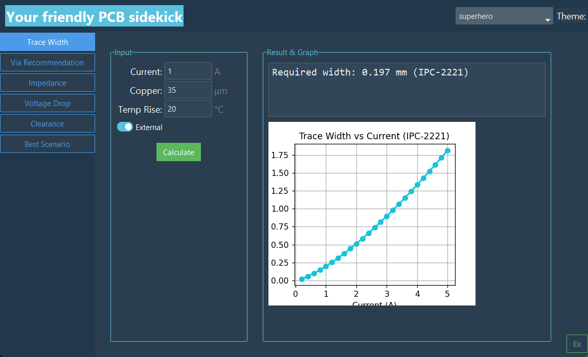
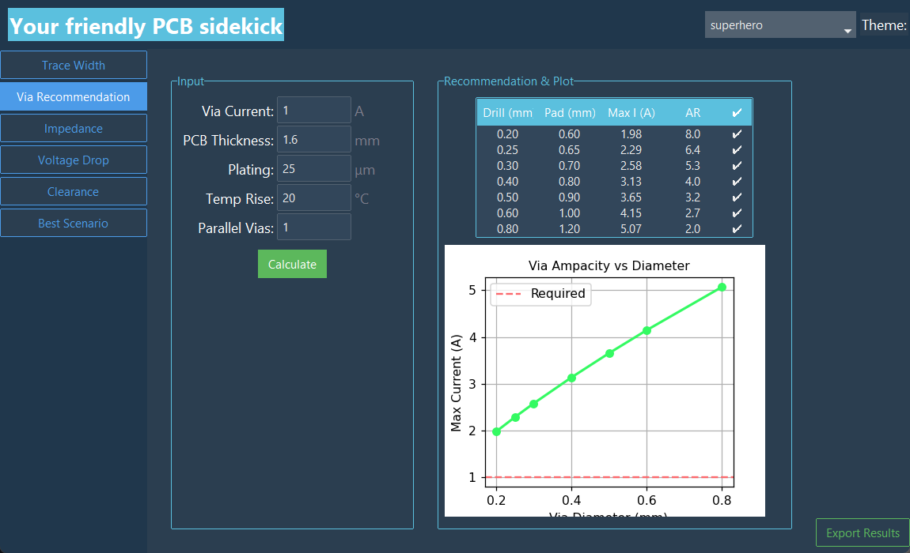
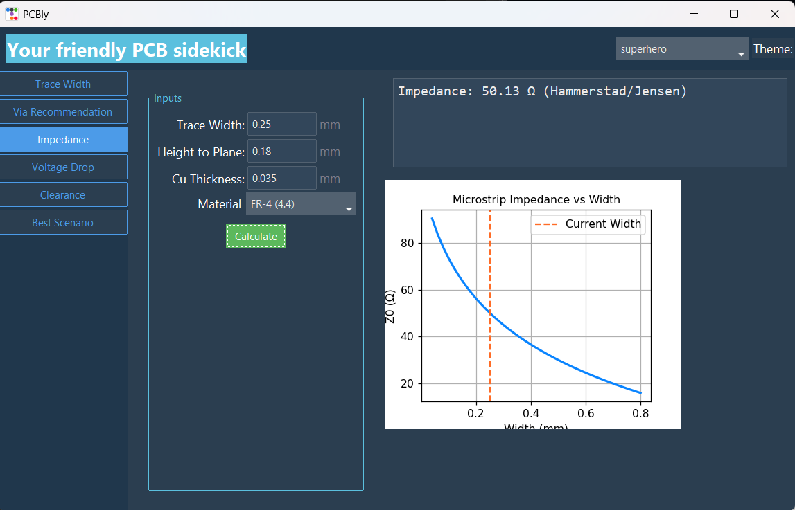
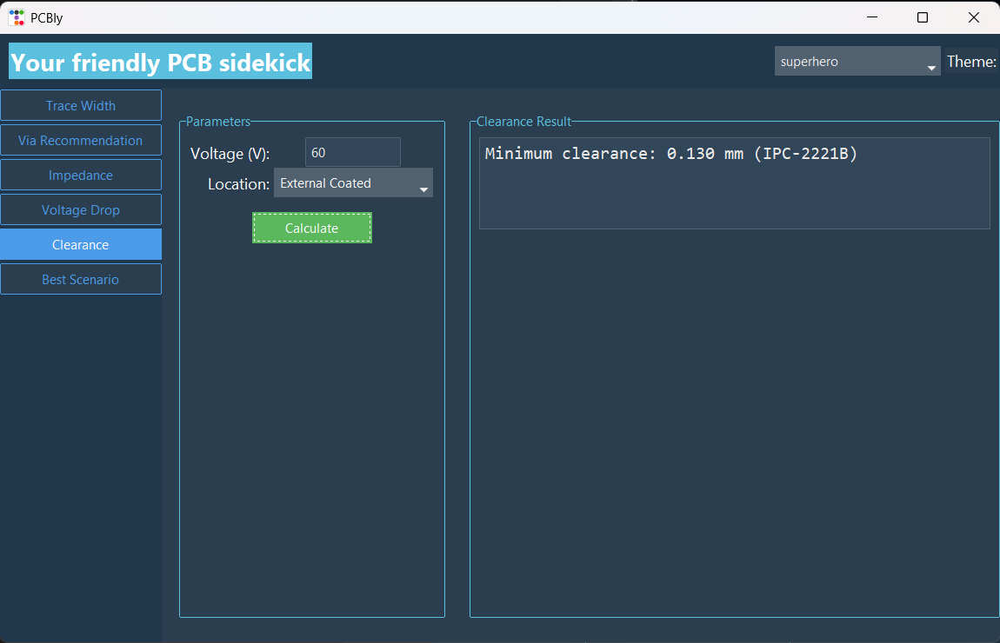
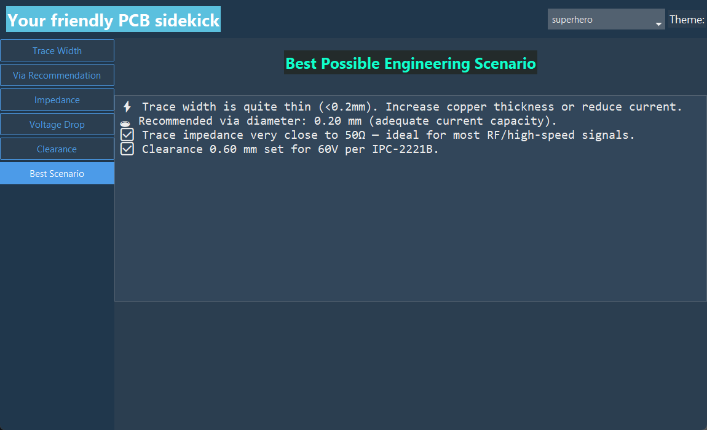

<div align="center">

# PCBly: your friendly PCB sidekick

**A free desktop calculator for PCB designers: IPC-2221 trace width, via current capacity, microstrip impedance, voltage drop and IPC-2221B clearance, with live plots and one-click report export.**




</div>

---

## Why

Every PCB layout session hits the same questions: *How wide should this power trace be? Will one via carry 2 A? Is this track 50 Ω?* PCBly answers them in one window, offline, without hunting for a different web calculator each time.

## Tools

| Tool | What you get |
|---|---|
| **Trace width** (IPC-2221) | Minimum width for a given current, copper weight and temperature rise, internal or external layer, plotted against current |
| **Via recommendation** | A table of via drill / pad sizes with current capacity (A, IPC-2221 on the plated barrel) and aspect ratio, for any number of parallel vias |
| **Microstrip impedance** | Z₀ via Hammerstad–Jensen for FR-4, Rogers 4350B or polyimide, plotted against trace width |
| **Voltage drop** | Trace resistance, voltage drop and power loss |
| **Clearance** (IPC-2221B) | Minimum conductor spacing for a voltage and board location |
| **Best scenario** | A plain-English summary of all your results, with suggestions |
| **Export** | Save every result to a `.txt` report for your design notes |

## Screenshots

<table>
<tr>
<td width="50%"><br/><sub>Via recommendation</sub></td>
<td width="50%"><br/><sub>Microstrip impedance</sub></td>
</tr>
<tr>
<td width="50%"><br/><sub>Clearance (IPC-2221B)</sub></td>
<td width="50%"><br/><sub>Best-scenario summary</sub></td>
</tr>
</table>

## Quick start

```bash
git clone https://github.com/Prateek-elec/pcbly-toolkit.git
```
```bash
cd pcbly-toolkit/PCBLy
```
```bash
pip install -r requirements.txt
```
```bash
python main.py
```

Requires Python 3.8+ with Tkinter (included in the standard Python installers for Windows and macOS).

## Accuracy note

PCBly uses published approximations: the IPC-2221 conductor-sizing equation `I = k·ΔT^0.44·A^0.725` (k = 0.048 external, 0.024 internal) for traces and via barrels, the IPC-2221B clearance table and the Hammerstad–Jensen microstrip model. IPC-2221 is the classic standard; the newer IPC-2152 charts can give different widths depending on the stackup. It's meant for fast early-stage estimates. For production boards, confirm critical values with your fab's stackup and a field solver.

## Roadmap

- [ ] Stripline and differential-pair impedance
- [ ] Unit toggle (mm / mil, µm / oz)
- [ ] Packaged `.exe` release for Windows
- [ ] Unit tests against reference values

## Contributing

Found a wrong number, or want another calculator? [Open an issue](https://github.com/Prateek-elec/pcbly-toolkit/issues) or send a pull request.

## License

[MIT](LICENSE) © Prateek Sarkar

<div align="center">

**If PCBly saved you a trip to five calculator websites, a ⭐ is appreciated.**

</div>
